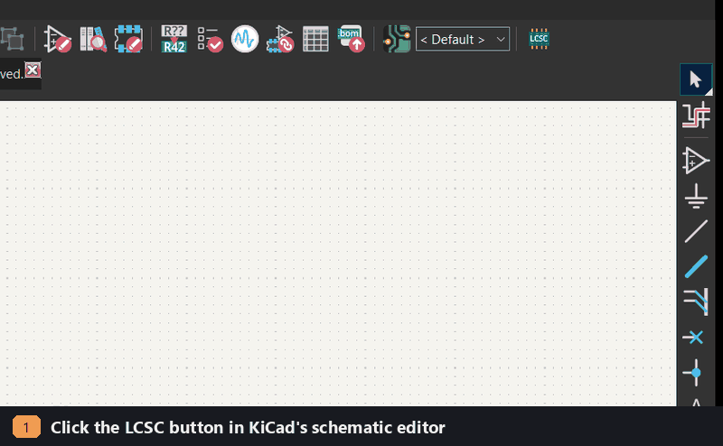
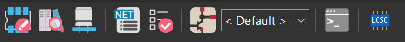
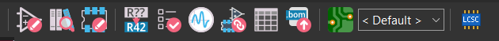
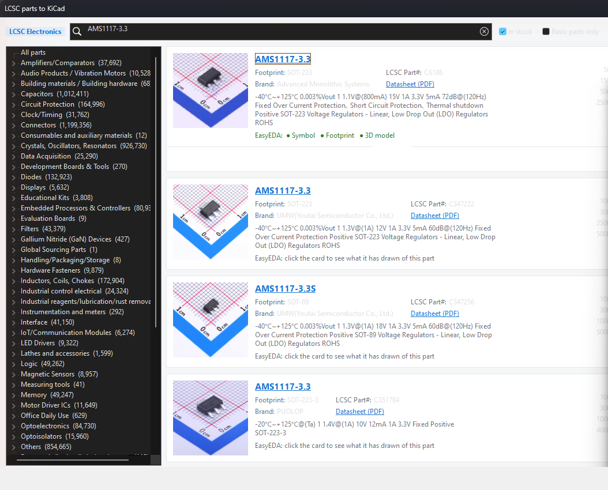
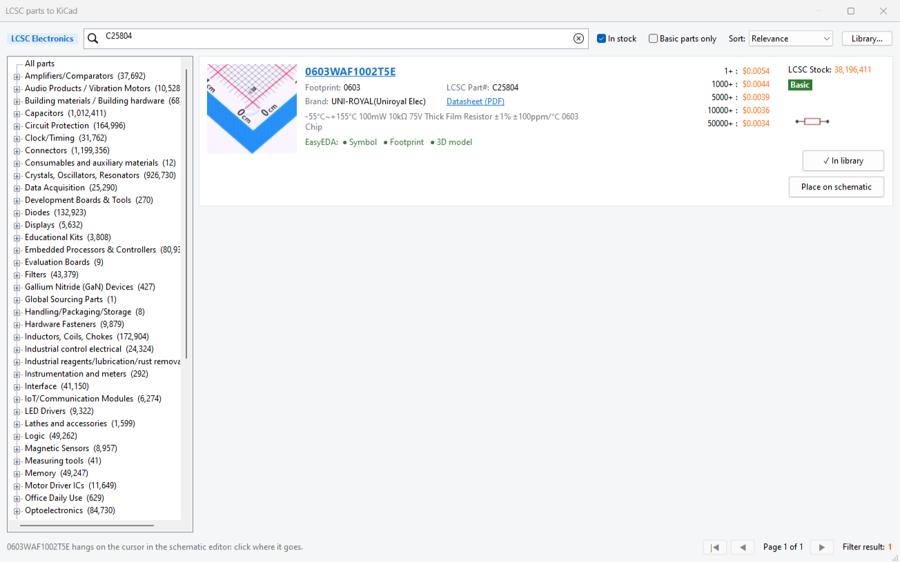
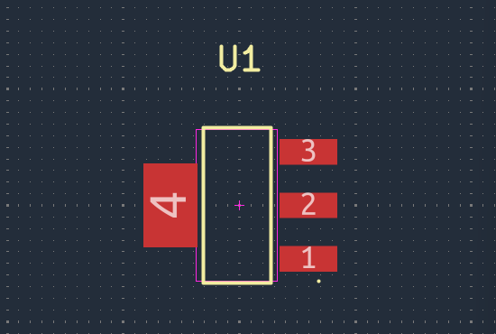
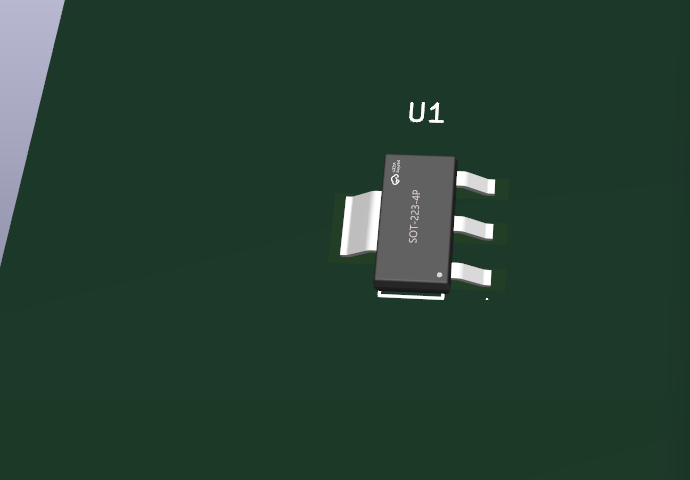
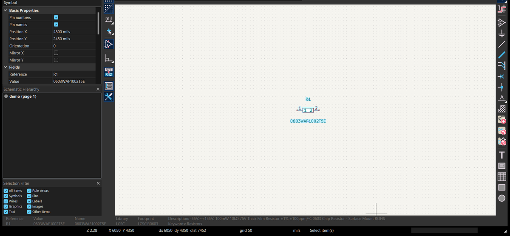

# KiCad JLCPCB part picker

*LCSC parts to KiCad*


A KiCad add-on (KiCad 8–10) to **search LCSC/JLCPCB's parts from inside KiCad and drop them straight into your design**: a part selector like EasyEDA's, opened from a toolbar button in the PCB editor and the schematic editor. Pick a part and it is imported into your own KiCad library (symbol, footprint and 3D model, via [easyeda2kicad](https://github.com/uPesy/easyeda2kicad.py)), checked, and placed on the board or schematic, so the board can go to JLCPCB assembly as it is.

<p align="center"></p>

### Quick install (Windows, KiCad 10)

1. [Download the latest ZIP](https://github.com/Abdulhamid-Baghdadi/kicad-jlcpcb-part-picker/releases/latest) and unpack it.
2. In a terminal in that folder: `python -m pip install easyeda2kicad`, then `python install.py`.
3. In KiCad's PCB editor: **Tools › External Plugins › Refresh Plugins**: the **LCSC** button is on the top toolbar. For the schematic editor, also turn on **Preferences › Plugins › Enable KiCad API** and restart KiCad.

Click the button, search `C6186`, press **Place on board**. Step-by-step details, macOS/Linux and troubleshooting are in [Installation](#installation).

**Features**
- Search or browse LCSC's whole catalogue from KiCad: by part, value or LCSC number; in stock / Basic parts only; sorted by stock or price.
- One click imports symbol + footprint + 3D model (STEP) into your own library, with maker, part number, datasheet and LCSC number on the symbol.
- Every import is checked: pins without pads and missing 3D models are reported.
- **Place on board** and **Place on schematic**, straight from the result.
- Works from the PCB editor, the schematic editor, on its own, or from the command line (also for making a project-local library).

## What you get

| | |
| --- | --- |
| **A button in the PCB editor** (top toolbar, with the other plugins) |  |
| **A button in the schematic editor** (needs KiCad's API on, see step 5) |  |

**The part selector.** Categories with part counts on the left; search by part name, value or LCSC number; filter *In stock* / *Basic parts only*; sort by stock or price. Each result shows photo, footprint, maker, LCSC number, datasheet, price breaks, stock and Basic/Extended:



**A part's detail.** Click a card: it shows what EasyEDA has drawn of it (symbol, footprint, 3D model) and a picture of its symbol, with **Import** and **Place on board** / **Place on schematic**:



**The part in your design.** On the board with the next free reference, its footprint from the `LCSC` library and its 3D model linked; or on the schematic with its footprint (`LCSC:R0603`) and LCSC record already filled in:

<p>


</p>


It searches LCSC's parts, as JLCPCB's parts search finds them, imports those you choose into a KiCad library of your own, and puts them on the board open in the PCB editor. Each part comes as EasyEDA has drawn it:
- its symbol, with its footprint already set and its LCSC number;
- its footprint;
- its 3D model, as STEP where there is one, so that KiCad's STEP export has it;
- LCSC's record of it in its symbol, as hidden fields: its maker, part number, description and datasheet; its prices and stock in `records.json` beside the library.

Each part imported is checked, as the studio checks its own library: every pin of its symbol has a pad of its number on its footprint, and the 3D model its footprint names is there. EasyEDA draws some parts' symbols and footprints apart; the check says so (*PROBLEM C2927039 USB-TYPE-C-019: pins 1, A1, A12, A4, A9 have no pad…*), and a pad no pin names, such as a shield, is noted.

KiCad's own library does not tie a symbol to one footprint; here every part is a symbol and its footprint together, and one JLCPCB can assemble.

## Installation

Tested on Windows 11 with KiCad 10.0.1. The steps are the same on macOS and Linux except where noted.

**1. Install KiCad 8, 9 or 10** from [kicad.org](https://www.kicad.org/download/) and start it once, so that it creates its folder in your Documents.

**2. Install Python 3 and easyeda2kicad.** easyeda2kicad does the conversion and runs in an ordinary Python, not KiCad's. In a terminal (on macOS/Linux, `python3`):

```bash
python -m pip install easyeda2kicad
```

Check it works; it must print a usage line with `--lcsc_id`:

```bash
python -m easyeda2kicad --help
```

The add-on looks for `python`, `python3` and `py` on the PATH. If your Python is elsewhere, see *Troubleshooting*.

**3. Get the add-on**: download `kicad-jlcpcb-part-picker-<version>.zip` from the [latest release](https://github.com/Abdulhamid-Baghdadi/kicad-jlcpcb-part-picker/releases/latest) and unpack it, or clone the repository:

```bash
git clone https://github.com/Abdulhamid-Baghdadi/kicad-jlcpcb-part-picker.git
```

**4. Run the installer** from that folder:

```bash
python install.py
```

It copies the add-on into the plugins folder of your newest KiCad (`Documents/KiCad/<version>/scripting/plugins/lcsc_to_kicad`) and the schematic button into `Documents/KiCad/<version>/plugins/lcsc-to-kicad`, and prints where it put them.

**5. Turn the buttons on in KiCad.**
- *PCB editor:* open a board, then **Tools › External Plugins › Refresh Plugins**. The **LCSC** button appears at the right end of the top toolbar.
- *Schematic editor:* **Preferences › Preferences… › Plugins › Enable KiCad API**, then restart KiCad. The first start sets up a small Python environment for the button (a few seconds); the button then shows at the right end of the schematic editor's top toolbar.

**6. Check it worked.** Click the button, type `C6186` and press Enter: the AMS1117-3.3 regulator appears. Click its card, then **Place on board** (or **Place on schematic**): the status line says it was imported and placed, and the part is in your design. The first import also adds the library **LCSC** to KiCad's global symbol and footprint tables.

To update later: get the new version (new ZIP, or `git pull`), then run `python install.py` again. To remove: `python install.py --remove`.

### Troubleshooting

| Problem | What to do |
| --- | --- |
| *"easyeda2kicad was not found"* | Run step 2 again. If that Python is not on the PATH, or the PATH finds another one first, name it in `~/.lcsc-to-kicad.json`: `{"python": "C:/Path/To/python.exe"}`. Versions before 1.0.0 also showed this when KiCad had been started from a terminal; update with `git pull` and `python install.py`. |
| No button in the PCB editor | **Tools › External Plugins › Refresh Plugins**, or restart KiCad. Check that `Documents/KiCad/<version>/scripting/plugins/lcsc_to_kicad` exists; with several KiCad versions, the installer uses the newest. |
| No button in the schematic editor | It shows only with **Enable KiCad API** on, after a restart; give the first start a few seconds, then open the schematic editor again. |
| *"KiCad's folder was not found"* when installing | Start KiCad once, then run `python install.py` again. |
| Search works, but importing fails after several parts | EasyEDA refuses many requests in a row for a few minutes; wait and try again. |
| **Place on schematic** did not paste (macOS/Linux, or the editor was not brought forward) | The symbol is on the clipboard: click into the schematic editor and press Ctrl+V (Cmd+V). |

## Using it

1. In the PCB editor or the schematic editor, click the **LCSC** button.
2. Pick a category, or type a part, a value or an LCSC number (*AMS1117-3.3*, *10k 0603*, *C6186*) and press Enter.
3. Click a card to see what EasyEDA has drawn of it.
4. **Import** adds it to your library; **Place on board** / **Place on schematic** imports it if needed and puts it in your design. On the board it lands in the middle, beside the parts already there: close the window to move it. On the schematic it hangs on the cursor: click where it goes.
5. Imported parts are also in KiCad's own **Place › Add Symbol** and **Add Footprint**, in the library **LCSC**.

The details, the command line and the optional server mode follow.

## FAQ and limitations

**Is it an official LCSC, JLCPCB or EasyEDA tool?** No. It uses the websites' own, unofficial endpoints for search and part data, which may change or rate-limit; use them as their terms allow.

**Which KiCad versions?** Tried end to end on KiCad 10.0.1 (Windows 11). The PCB editor button uses KiCad's Python plugin interface, which KiCad 8 and 9 have too; the schematic editor button needs KiCad's IPC API (KiCad 9 and later). macOS and Linux are expected to work, but have not been tried; there, **Place on schematic** leaves the symbol on the clipboard for you to paste.

**Why does the schematic button need the API, and why does it paste?** KiCad shows its older Python plugins only in the PCB editor, and KiCad 10's API cannot add a symbol to a schematic yet. So the button is an API plugin, and the window puts the symbol on the clipboard as KiCad copies one and presses Ctrl+V in the schematic editor.

**Are EasyEDA's drawings always right?** Not always: some parts' symbols and footprints number their pins differently. The check after each import says so (*PROBLEM … pins 1, A1 … have no pad*); look at the part before you order boards.

**Where do the parts go, and can I share the library with a project?** By default into `Documents/KiCad/lcsc-library`, added to KiCad's global tables. `run.py C6186 --out libs --project <board folder>` makes a library in `libs` and lists it in that project's own tables, by a path relative to the project. The footprints name their 3D models by the library's full path on this computer, so on another computer the 3D models need the library at the same place (or KiCad's path variable, see `--use`).

**Is easyeda2kicad included?** No; it is AGPL-3.0 and you install it yourself (step 2). The add-on runs it as a separate program.

**How do I remove it?** `python install.py --remove` takes both buttons out. Your library and its entries in KiCad's tables stay; remove them in **Preferences › Manage Symbol/Footprint Libraries** if you like.

## Reference

### In the schematic editor

KiCad shows its older Python plugins, such as this tool's button, only in the PCB editor. For the schematic editor, `install.py` also installs a button of KiCad's newer kind (`schematic/`, in `Documents/KiCad/<version>/plugins/lcsc-to-kicad`), which opens the same window with KiCad's own Python. KiCad shows such buttons once its API is on: **Preferences › Preferences… › Plugins › Enable KiCad API**, then restart KiCad. The first start after installing makes the button a Python environment of its own, which takes a few seconds; the button shows in schematic editors opened after that. Opened there, each part has **Place on schematic** (see below); **Place › Add Symbol** finds the parts imported in the library **LCSC** too.

### Buttons, window and command line in detail

- **In KiCad's PCB editor:** run `python install.py` once, then in the PCB editor **Tools › External Plugins › Refresh Plugins**; the button **LCSC parts to KiCad** is on the top toolbar, among the plugins. To have the plugins' buttons on the right toolbar, beside the drawing tools, as KiCad 10 lets you arrange its toolbars: open **Preferences › Preferences… › PCB Editor › Toolbars** once and press **OK**, so that KiCad writes them down, then run `python install.py --sidebar` and restart KiCad (`--no-sidebar` puts them back; the files before are kept as `*.before-lcsc`).
- **On its own:** double-click `LCSC to KiCad.bat` (Windows), or run `run.py` with KiCad's Python.
- **From the command line:** `python run.py C6186 C25804` imports those parts without the window; `python run.py C6186 --out MyParts` makes a library of them in the folder `MyParts`, leaving KiCad's settings as they are, and `--project <board folder>` lists it in that project's own symbol and footprint tables; `python run.py --check [<folder>]` checks a library, yours or the one in the folder; `python run.py --retire` takes a library kept on this computer out of KiCad's global tables, and `python run.py --use <folder>` points them at the server's (below).

In the window, laid out as EasyEDA's part selector:
1. Choose a category on the left, with how many parts each holds, or type a part, a value or an LCSC number (*AMS1117-3.3*, *10k 0603*, *C6186*) and press Enter. **In stock** and **Basic parts only** narrow the results, Basic parts being those JLCPCB assembles without a setup fee, and **Sort** orders them by stock or price.
2. Each part is a card: its photo, its name (a link to its LCSC page), its footprint, maker, LCSC number and datasheet, its price at each quantity, its stock, and whether it is Basic or Extended.
3. Click a card to see what EasyEDA has drawn of it, symbol, footprint and 3D model, with a picture of its symbol. It is asked one part at a time: EasyEDA turns away many requests at once for a few minutes.
4. **Import** puts it into your library; **✓ In library** marks those already there, and a right-click imports one again, replacing it.
5. Opened from the PCB editor, **Place on board** puts it on the open board, imported first when it is not yet in the library: its footprint, named by its library (`LCSC:…`, so that **Update Footprints from Library** finds it), with the next free reference of its kind, its value and its LCSC number, maker and part number as hidden fields, in the middle of the board, beside the parts already there. Close the window to move it.
6. Opened from the schematic editor, **Place on schematic** hangs its symbol on the cursor there, imported first when it is not yet in the library: click where it goes, as after **Place › Add Symbol**. It is named by its library (`LCSC:…`), its reference left to be numbered (`U?`), with its value, footprint and LCSC record. KiCad's API cannot add to a schematic yet, so the window pastes it: it puts the symbol on the clipboard as KiCad copies one, brings the schematic editor forward and presses Ctrl+V there. Where it cannot bring it forward (or on macOS and Linux), it says so: press Ctrl+V in the schematic editor yourself.

### Where the parts go

By default, into a library on your computer (second paragraph below). The tool was written as part of a larger project, Modular Electronics Studio, and can optionally send parts to that project's server instead; most users can ignore that part.

**Library…** asks for the desktop link that Modular Electronics Studio's page gives (**Connect a desktop program…**). With it, each part is converted on the server and goes into its LCSC library, `library/lcsc/kicad`: its symbol, footprint and 3D model, and an element of its own, whose pins are its ports, with the part's record from LCSC. The page's **Parts from LCSC…** adds parts to the same library. Every KiCad project the server writes takes the library along in its `libraries/` folder, listed as **LCSC** in the project's own symbol and footprint tables, so KiCad needs no global library.

Without a link, the tool keeps a library on this computer, as it did before: `Documents/KiCad/lcsc-library/LCSC.kicad_sym`, `LCSC.pretty` and `LCSC.3dshapes`, added to KiCad's global symbol and footprint tables at the first import (copies kept as `*.before-lcsc`). To move to the server's library, give **Library…** the link, and run `python run.py --retire`: it takes **LCSC** out of KiCad's global tables, keeping copies as `*.before-retire`, so that a project's own **LCSC**, the server's, is the one KiCad finds. The folder on this computer is then no longer used; delete it when you like.

When the server runs on this computer, KiCad can use its library directly, in any project, not only those the server writes: `python run.py --use "<repository>/library/lcsc/kicad"` sets KiCad's path variable `LCSC_LIBRARY` to that folder, by which the library's footprints name their 3D models, and lists **LCSC** in KiCad's global symbol and footprint tables by it (`${LCSC_LIBRARY}/LCSC.kicad_sym` and `LCSC.pretty`), keeping the files before as `*.before-use`. Restart KiCad to see it. A project's own **LCSC**, the copy in its `libraries/` folder, still comes first in that project.

### Files

| File | What it is |
| --- | --- |
| `lcsc_to_kicad/core.py` | searching, converting with easyeda2kicad, LCSC's record, the check, where KiCad finds a footprint, and KiCad's library tables |
| `lcsc_to_kicad/place.py` | putting a part on the board, with KiCad's Python |
| `lcsc_to_kicad/paste.py` | putting a part's symbol on the schematic, through the clipboard |
| `lcsc_to_kicad/dialog.py` | the window |
| `lcsc_to_kicad/__init__.py` | the PCB editor's button |
| `run.py`, `LCSC to KiCad.bat` | the window on its own, and the command line |
| `install.py` | copies the plugin into KiCad's plugins folder, and the schematic editor's button into KiCad's API plugins folder; `--remove` takes both out; `--sidebar` moves the plugins' buttons to the right toolbar |
| `schematic/` | the schematic editor's button: `plugin.json`, `open_window.py`, which opens the window with KiCad's Python, and `requirements.txt`, empty, which KiCad needs before it shows the button |

## Licence

MIT, see [LICENSE](LICENSE). The conversion is done by [easyeda2kicad](https://github.com/uPesy/easyeda2kicad.py) (AGPL-3.0), which you install yourself; it is run as a separate program, and none of its code is in this repository. JLCPCB's and EasyEDA's search and part data come from their websites' own, unofficial, endpoints; use them as their terms allow.

Written by Abdulhamid Baghdadi, 2026.
